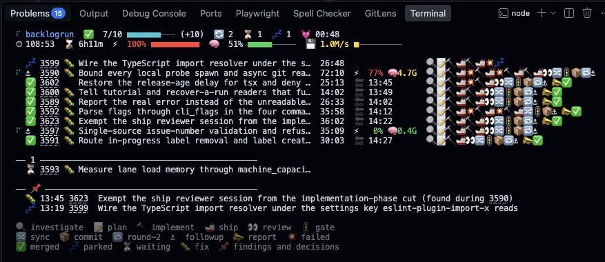

# @joshuafolkken/kit

**AI assistant setup, plus an optional GitHub workflow.**

kit gives Claude Code or Codex your project's rules and checks.

## The workflow

Type `backlogrun` and the agent takes the Issues you name from plan to merged PR — in parallel, unattended. A live board shows where each one stands:



[Every keyword, including the ones that stop for you earlier](./docs/how-to/run-issues.md)

## Sound familiar?

[The whole story](./docs/why.md)

- [I keep repeating the same instructions](./docs/why.md#i-keep-repeating-the-same-instructions)
- [The agent does things I never asked for](./docs/why.md#the-agent-does-things-i-never-asked-for)
- [Wiring AI up to GitHub is a chore](./docs/why.md#wiring-ai-up-to-github-is-a-chore)
- [Done doesn't mean done](./docs/why.md#done-doesnt-mean-done)

## Quick start

### With the GitHub workflow

Requires [Node.js, pnpm and the gh CLI](./docs/setup/prerequisites.md).

```bash
gh auth login # once
pnpm add -D --allow-build=esbuild --allow-build=unrs-resolver @joshuafolkken/kit
pnpm exec josh start
```

Next: [tutorial](./docs/tutorial.md)

### AI assistant only — no GitHub account needed

Requires [Node.js and pnpm](./docs/setup/prerequisites.md).

```bash
pnpm --allow-build=esbuild dlx @joshuafolkken/kit init
```

Next: [tutorial](./docs/tutorial.md#without-github-one-change-checked-locally)

## Docs

[How-to](./docs/how-to.md) · [All docs](./docs/overview.md)

[app-kit](https://github.com/joshuafolkken/app-kit) · [game-kit](https://github.com/joshuafolkken/game-kit) · [Releases](https://github.com/joshuafolkken/kit/releases) · [Contributing](./docs/maintainers/README.md)
